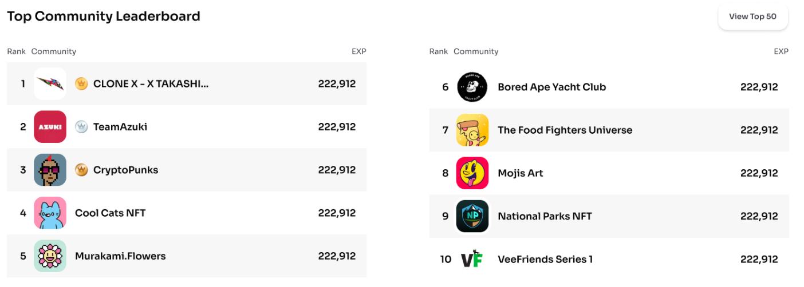

### Introduction to Communities and Leaderboards
A leaderboard is an exciting feature we have developed for one of our top clients at Frame One Software that showcases the top-performing communities on their platform. It's more than just a list; it's a dynamic representation of community engagement and accomplishment. Here's how it works:

**Point Accumulation:** Every user earns points through various activities and contributions within their community. These activities could range from posting content to engaging in discussions, each adding to their point tally.

**Community Performance:** The collective performance of a community is determined by the sum of points accumulated by all its members. This aggregation reflects the overall activity and engagement level of the community.

**Competitive Edge:** The leaderboard ignites a competitive spirit, encouraging users to actively participate and contribute to their communities. It's not just about individual glory; it's about rallying together to lift your community to the top.

**Engagement and Motivation:** By displaying the top communities, the leaderboard fosters a sense of achievement and motivation. It's a visual testament to the power of community effort and engagement.

**Technical Insights:** For an in-depth understanding of how users and communities are structured and how points are tracked, delve into User.ts and Community.ts in our backend codebase.

This leaderboard isn't just a feature; it's a catalyst for community growth and engagement. It's about celebrating the collective efforts and achievements of vibrant communities. 

Example of a real leaderboard:



## Project Initialization

This project requires Node.js version 20.0.0 or higher. If you already have Node.js installed and need to upgrade, we recommend using Node Version Manager (NVM). You can find NVM at this link: https://github.com/nvm-sh/nvm. However, using NVM is optional.

To check your Node.js version, run the following command in your terminal:

```
node --version
```

This project uses PNPM instead of NPM. If you don't have PNPM installed, you can install it by running the following command:

```
npm install -g pnpm
```

Once you have the correct Node.js version and PNPM installed, navigate to the root of the project directory and install the project dependencies by running:

```
pnpm install
```

After the installation is complete, you can initialize the project. The project has universal run scripts, but the frontend and backend can be run separately as well. Here are the commands you can use:

To run the entire project:

```
pnpm dev
```

To run only the backend:

```
pnpm dev:backend
```

To run only the frontend:

```
pnpm dev:frontend
```

## Setting Up MongoDB with Docker

This section guides you through the process of setting up MongoDB locally using Docker. Docker simplifies the management of MongoDB, ensuring a consistent and isolated environment for your database.

### Prerequisites
- **Docker Installation:** Ensure Docker is installed on your machine. If not, download and install Docker Desktop from [Docker's official website](https://www.docker.com/products/docker-desktop).

### Steps to Run MongoDB

1. **Pull MongoDB Image:** Use the command below to pull the latest MongoDB image from Docker Hub:

   ```
   docker pull mongo
   ```
   This step downloads the official MongoDB image to your machine.

2. **Start MongoDB Container:** Run the MongoDB container with the following command:
   ```
   docker run -d -p 27017-27019:27017-27019 --name mongodb mongo
   ```
   This command initiates a MongoDB container named `mongodb`, and maps the ports `27017` to `27019` from the container to the host, making the database accessible on these ports.

3. **Accessing MongoDB:** The MongoDB instance is now running on `localhost` on port `27017`. You can connect to it using any MongoDB client or via the command line.

### Stopping the MongoDB Container

To stop the running MongoDB container, execute:
```
docker stop mongodb
```
This command halts the 'mongodb' container, effectively stopping the MongoDB instance.


### Connecting to MongoDB Using Mongo Compass

Mongo Compass is a GUI client for MongoDB. To connect your MongoDB instance with Mongo Compass:

1. **Install Mongo Compass:**
Download and install Mongo Compass from [MongoDB's official page](https://www.mongodb.com/products/tools/compass).

2. **Launch and Connect:**
   - Open Mongo Compass.
   - In the connection string field, enter: `mongodb://localhost:27017`.
   - Click "Connect" to establish a connection with your local MongoDB instance.

You should now be successfully connected to your MongoDB instance via Mongo Compass.

## Generating Data

After connecting to MongoDB and running the backend, you can generate dummy data to work with by using the following endpoints. Simply type these URLs into your browser to trigger them:

1. **Inflate Database:**
   - Call [`http://localhost:8080/utils/inflate-db`](http://localhost:8080/utils/inflate-db)
   - This endpoint inflates the database with dummy data. It creates 100 users and 10 communities.

2. **Drop Database:**
   - Call [`http://localhost:8080/utils/drop-db`](http://localhost:8080/utils/drop-db)
   - This endpoint deletes all users and communities from the database.


